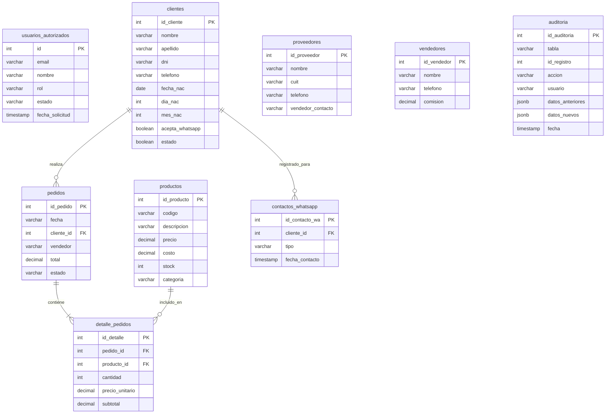

# Manual Técnico de Arquitectura e Implementación — Sistema de Gestión Ivi

> **Versión Técnica:** 2.1 — Producción / Local  
> **Motor de Base de Datos:** PostgreSQL 18.6 (x64) / Supabase  
> **Servidor Web:** Apache 2.4 + PHP 8.x  
> **Fecha de Actualización:** Octubre 2026  
> **Documentos de Referencia:** [`/AGENTS.md`](/AGENTS.md), [`/DATABASE.md`](/DATABASE.md), [`/database/init_postgres_ivis.sql`](/database/init_postgres_ivis.sql)

---

## 1. Visión General y Arquitectura de 4 Capas

El **Sistema de Gestión Ivi** está estructurado bajo una **Arquitectura de 4 Capas**, desacoplando reglas de negocio, habilidades de agentes, código ejecutable de sectores y telemetría:

```mermaid
graph TD
    subgraph Capa 1: Directivas (Reglas de Negocio)
        D1[build_system.md]
        D2[build_ventas.md]
        D3[build_crm.md]
        D4[build_stock.md]
    end

    subgraph Capa 2: Orquestación & Skills (Regla 1:3)
        S1[Ventas: sales_manager / pricing_calculator / checkout_validator]
        S2[CRM: customer_journey / lead_profiler / retention_guardian]
        S3[Stock: inventory_tracker / stock_replenishment / catalog_auditor]
    end

    subgraph Capa 3: Ejecución de Sectores & APIs
        E1[ventas/ - Módulo de Ventas]
        E2[crm/ - Módulo CRM]
        E3[stock/ - Módulo Stock]
        E4[api/ - Endpoints REST PHP]
        E5[styles/ - Sistema Visual ADN Placas independientes]
    end

    subgraph Capa 4: Observabilidad & Base de Datos
        O1[ivi_db - PostgreSQL 18 / Supabase RLS]
        O2[tests/ - Suite de Regresión Automatizada]
        O3[auditoria - Tabla centralizada JSONB]
    end

    Capa 1 --> Capa 2
    Capa 2 --> Capa 3
    Capa 3 --> Capa 4
```

### Capa 1: Directivas Rectoras (`directives/`)
Documentos normativos que rigen contratos de datos, flujos de transición de estados y directrices de interfaz:
- [`/directives/build_system.md`](/directives/build_system.md): Estándar técnico, paleta de colores y componentes visuales.
- [`/directives/build_ventas.md`](/directives/build_ventas.md): Reglas de checkout, cálculo de márgenes y umbrales de búsqueda.
- [`/directives/build_crm.md`](/directives/build_crm.md): Ciclo de fidelización, reglas de cumpleaños y clasificación de compradores.
- [`/directives/build_stock.md`](/directives/build_stock.md): Control de inventario multialmacén y reposición.

### Capa 2: Orquestación de Agentes (Regla 1:3)
Cada sector de negocio se gobierna por exactamente **3 Skills especializadas** alojadas en `.agents/skills/`:
- **Ventas**: `sales_manager` (gestor operativo), `pricing_calculator` (cálculo de importes y recargos), `checkout_validator` (guardián transaccional).
- **CRM**: `customer_journey` (ciclo de vida del cliente), `lead_profiler` (calificación de prospectos), `retention_guardian` (prevención de abandono y fidelización).
- **Stock**: `inventory_tracker` (kardex de inventario), `stock_replenishment` (cálculo de punto de pedido), `catalog_auditor` (guardián de SKUs y costos).

### Capa 3: Ejecución y Componentes de Software
- **Frontend Modular**: HTML5 semántico y JavaScript ES6+ sin frameworks pesados ni dependencias externas.
- **ADN Placas independientes (CSS)**: Arquitectura de estilos con cero estilos inline, organizada en `variables.css`, `base.css`, `layout.css`, `components.css`.
- **Backend REST**: Microservicios en PHP 8.x con persistencia nativa en PostgreSQL.

### Capa 4: Observabilidad, Persistencia y Validación
- **Base de Datos Relacional**: PostgreSQL 18 local (`ivi_db`) y compatible con Supabase Cloud.
- **Suite de Pruebas**: Ejecutor automatizado en el cliente con 8 suites y 23 aserciones de regresión (100% OK).

---

## 2. Stack Tecnológico y Requisitos del Entorno

| Componente | Tecnología / Versión | Rol en el Sistema |
|---|---|---|
| **Motor de Base de Datos** | PostgreSQL 18.6 (x64) | Almacenamiento transaccional, llaves foráneas y RLS. |
| **Servidor Web** | Apache 2.4.58 (Win64) | Servidor HTTP local con soporte de rewrite y PHP. |
| **Backend API** | PHP 8.2 / 8.3 CLI + mod_php | Endpoints REST JSON para persistencia de datos. |
| **Frontend Core** | HTML5 + JavaScript ES6+ | Interfaz reactiva en cliente sin compilación previa. |
| **Sistema Visual** | CSS3 Vanilla (Tokens & CSS Variables) | Metodología "ADN Placas independientes", Mobile-First. |
| **Pruebas Automatizadas** | Suite custom en navegador (`tests/`) | Validación de directivas de UI, negocio y APIs. |

---

## 3. Estructura del Repositorio

```text
c:/TGPN/Ivi/
├── .agents/skills/            # Capa 2: 9 Skills de agentes (regla 1:3)
├── .env                       # Variables de entorno y credenciales (Ignorado por Git)
├── .env.example               # Plantilla de variables de entorno segura
├── .gitignore                 # Exclusiones de Git (secretos, logs, temporales)
├── AGENTS.md                  # Protocolo de arquitectura y estándares
├── DATABASE.md                # Especificación del esquema de base de datos
├── MANUAL_USUARIO.md          # Manual del operador y usuario final
├── MANUAL_TECNICO.md          # Este documento
├── README.md                  # Resumen del proyecto
├── index.html                 # Tablero integrador principal del sistema
├── login.html                 # Pantalla de inicio de sesión y Google OAuth
├── formularios.html           # Pruebas de componentes de entrada
│
├── api/                       # Capa 3: Endpoints REST backend
│   └── contactos_whatsapp.php # Endpoint de registro y consulta de contactos WA
│
├── assets/                    # Iconografía y recursos gráficos
│   └── icons/                 # Iconos Phosphor (gift, cake, whatsapp, star, etc.)
│
├── database/                  # Capa 4: DDL y migraciones SQL
│   └── init_postgres_ivis.sql # Script maestro DDL para PostgreSQL/Supabase
│
├── directives/                # Capa 1: Directivas normativas de negocio
│   ├── build_system.md
│   ├── build_ventas.md
│   ├── build_crm.md
│   └── build_stock.md
│
├── styles/                    # Capa 3: Sistema de diseño "ADN Placas independientes"
│   ├── variables.css          # Paleta HSL/Hex, tipografías y espaciados
│   ├── base.css               # Reset y tipografía global
│   ├── layout.css             # Grid, sidebar, topbar y navegación móvil
│   ├── components.css         # Chapas, chapitas, botones, modales y tablas
│   └── styles.css             # Agregador maestro
│
├── crm/                       # Sector CRM & Clientes 360°
│   ├── index.html
│   ├── crm.js
│   └── README.md
│
├── ventas/                    # Sector Ventas & Facturación
│   ├── index.html
│   ├── ventas.js
│   └── README.md
│
├── stock/                     # Sector Stock & Almacenes
│   ├── index.html
│   ├── stock.js
│   └── README.md
│
└── tests/                     # Capa 4: Suite de regresión automatizada
    ├── index.html             # Interfaz visual de ejecución de pruebas
    ├── ventas.test.js         # Código fuente de las 7 suites de prueba
    └── README.md
```

---

## 4. Modelo de Base de Datos Relacional (`ivi_db`)

El esquema de base de datos consta de **9 tablas maestras** en el esquema `public`, diseñadas bajo estándares ACID y con preparación para Row Level Security (RLS) en Supabase:



### Detalle de Tablas y Atributos

#### 1. `contactos_whatsapp`
Registra toda interacción comercial y fidelización enviada a clientes por WhatsApp:
- `id_contacto_wa`: Clave primaria autoincremental (`SERIAL PRIMARY KEY`).
- `cliente_id`: Clave foránea referenciando a `clientes(id_cliente) ON DELETE CASCADE`.
- `tipo`: Tipo de interacción (`VARCHAR(20)`). Valores válidos:
  - `'oferta_cumple'`: Aviso de beneficio comercial por mes de cumpleaños.
  - `'saludo_cumple'`: Saludo afectivo en el día exacto del cumpleaños.
  - `'habitual'`: Contacto de fidelización a clientes destacados ($\ge 2$ compras en el mes).
- `fecha_contacto`: Marca temporal del envío (`TIMESTAMPTZ DEFAULT CURRENT_TIMESTAMP`).

#### 2. `usuarios_autorizados` (Opción B)
Control de autorización para usuarios Google OAuth y credenciales locales:
- Campos: `id`, `email`, `nombre`, `rol` (`admin`, `vendedor`), `estado` (`pendiente`, `aprobado`, `rechazado`), `fecha_solicitud`.
- Soporta la función de seguridad RLS `es_usuario_aprobado()`.

#### 3. `auditoria`
Tabla unificada para auditoría transaccional:
- Campos: `id_auditoria`, `tabla`, `id_registro`, `accion` (`INSERT`, `UPDATE`, `DELETE`), `usuario`, `datos_anteriores` (`JSONB`), `datos_nuevos` (`JSONB`), `fecha`.

---

## 5. Especificación de la API REST Backend

### Endpoint: `/api/contactos_whatsapp.php`

**Archivo:** [`/api/contactos_whatsapp.php`](/api/contactos_whatsapp.php)  
**Protocolo:** HTTP/1.1 — Formato: `application/json; charset=utf-8`  
**Seguridad:** Lee credenciales automáticamente desde `.env` sin exponer datos al cliente.

#### Método GET (Consulta de Contactos)
- **URL**: `GET /api/contactos_whatsapp.php`
- **Parámetros Opcionales de Consulta**:
  - `cliente_id` (int): Filtra interacciones de un cliente específico.
  - `tipo` (string): Filtra por tipo (`oferta_cumple`, `saludo_cumple`, `habitual`).
- **Respuesta Exitosa (HTTP 200)**:
  ```json
  {
    "ok": true,
    "total": 4,
    "contactos": [
      {
        "id_contacto_wa": 14,
        "cliente_id": 6,
        "tipo": "saludo_cumple",
        "fecha_contacto": "2026-10-18T22:54:54.060151-03:00"
      },
      {
        "id_contacto_wa": 5,
        "cliente_id": 1,
        "tipo": "oferta_cumple",
        "fecha_contacto": "2026-02-10T21:30:29-03:00"
      }
    ]
  }
  ```

#### Método POST (Registro de Contacto)
- **URL**: `POST /api/contactos_whatsapp.php`
- **Headers Requeridos**: `Content-Type: application/json`
- **Cuerpo de la Petición (Payload)**:
  ```json
  {
    "cliente_id": 6,
    "tipo": "saludo_cumple"
  }
  ```
- **Validaciones Estrictas**:
  - `cliente_id` debe ser un número entero mayor a 0.
  - `tipo` debe ser estrictamente uno de los valores permitidos: `['oferta_cumple', 'saludo_cumple', 'habitual']`.
- **Ejecución Transaccional con CTE en PostgreSQL**:
  ```sql
  WITH t AS (
    INSERT INTO contactos_whatsapp (cliente_id, tipo, fecha_contacto)
    VALUES (6, 'saludo_cumple', CURRENT_TIMESTAMP)
    RETURNING id_contacto_wa, cliente_id, tipo, fecha_contacto
  )
  SELECT json_agg(t) FROM t;
  ```
- **Respuesta de Creación Exitosa (HTTP 201)**:
  ```json
  {
    "ok": true,
    "mensaje": "Contacto de WhatsApp registrado exitosamente en base de datos PostgreSQL.",
    "contacto": {
      "id_contacto_wa": 14,
      "cliente_id": 6,
      "tipo": "saludo_cumple",
      "fecha_contacto": "2026-10-18T22:54:54.060151-03:00"
    }
  }
  ```

### Endpoint: `/api/proveedores.php`

**Archivo:** [`/api/proveedores.php`](/api/proveedores.php)  
**Protocolo:** HTTP/1.1 — Formato: `application/json; charset=utf-8`  
**Seguridad:** Sincronización nativa con PostgreSQL `ivi_db` mediante credenciales seguras de `.env`.

#### Método GET (Listado de Proveedores)
- **URL**: `GET /api/proveedores.php`
- **Respuesta Exitosa (HTTP 200)**:
  ```json
  {
    "ok": true,
    "total": 5,
    "proveedores": [
      {
        "id": 1,
        "razon": "Natura Cosméticos",
        "contacto": "María Gómez",
        "tel": "02235869878",
        "email": "pedidos@natura.com.ar"
      },
      {
        "id": 5,
        "razon": "Ignacio - Infodumper",
        "contacto": "Ignacio",
        "tel": "2235869878",
        "email": "ignacio@infodumper.net"
      }
    ]
  }
  ```

#### Método POST (Alta y Modificación de Proveedor)
- **URL**: `POST /api/proveedores.php`
- **Cuerpo JSON**:
  - `id` (int, opcional): Si se incluye, actualiza el proveedor; si se omite, inserta un nuevo registro.
  - `razon` (string, obligatorio): Razón social o denominación del proveedor.
  - `contacto` (string): Nombre del contacto principal.
  - `tel` (string): Teléfono de pedidos.
  - `email` (string): Correo electrónico oficial.

---

## 6. Mecanismo de Sincronización Híbrida del CRM

Para garantizar velocidad instantánea en la interfaz ("cero latencia de respuesta al usuario") y al mismo tiempo persistencia corporativa sólida, el sistema implementa una **estrategia de sincronización híbrida**:

1. **Escritura Optimista en Cliente**:
   - Al hacer clic en *"Avisar Oferta Mes"* o *"🎂 ¡Felicitar Hoy!"*, la interfaz actualiza inmediatamente el objeto `localStorage.getItem('ivi_crm_notificaciones_cumple')`.
   - El botón pasa inmediatamente a la clase `.inutilizado` (`opacity: 0.38; filter: grayscale(85%)`).
2. **Replicación Inmediata en PostgreSQL**:
   - Se despacha una petición asíncrona `fetch` con método `POST` al endpoint `/api/contactos_whatsapp.php`.
   - La base de datos asigna `id_contacto_wa` secuencial y marca de tiempo auditable.
3. **Sincronización Bidireccional de Arranque**:
   - Al cargar la página (`DOMContentLoaded`) o al abrir el modal CRM (`abrirModalCRM()`), se invoca `sincronizarContactosDesdeBackend()`.
   - Se consultan los contactos existentes en PostgreSQL y se unifican con el estado local, garantizando que si otro operador envió un mensaje desde otra terminal, el botón se muestre atenuado en todas las estaciones de trabajo.

---

## 7. Suite de Pruebas Automatizadas de Regresión

El sistema cuenta con un ejecutor de pruebas automatizadas integrado en [`/tests/index.html`](/tests/index.html) respaldado por [`/tests/ventas.test.js`](/tests/ventas.test.js):

| Suite | Nombre de la Suite | Regla de Negocio / Directiva Verificada | Cantidad de Pruebas |
|:---:|---|---|:---:|
| **1** | Umbrales de Autocompletado Predictivo | Mínimo 3 caracteres para Cliente/Descripción, 1 carácter para Código. | 5 |
| **2** | Navegación de Teclado y Selección | Desplazamiento circular con flechas Arriba/Abajo y selección con Enter. | 2 |
| **3** | Consolidación de Productos Duplicados | No generar filas duplicadas, sumar cantidades y recalcular subtotales. | 2 |
| **4** | Integridad de Interfaz y Cero Alerts | Cero diálogos nativos (`alert`, `confirm`), modales corporativos y toasts. | 3 |
| **5** | Liquidación y Formateo de Precios | Formato estándar argentino (`$ 28.500,00`) y precisión aritmética. | 3 |
| **6** | Apertura y Edición de Registros en Modales | Despliegue y vinculación interactiva de edición directa en directorios. | 3 |
| **7** | Panel CRM, Diferenciación WhatsApp y BD | Validación de `oferta_cumple`, `saludo_cumple`, regla `inutilizado` y endpoint REST. | 3 |
| **8** | Regla 4.4: Descuento de Stock en Pendiente | Stock se da de baja al confirmar en `PEN`, se mantiene en `PAG` y se reintegra en `CAN`. | 4 |
| **TOTAL** | **8 Suites de Regresión** | **Cumplimiento Integral de Directivas del Sistema** | **23 Aprobadas (100% OK)** |

Para ejecutar las pruebas:
```text
http://localhost/ivi/tests/index.html
```

---

## 8. Despliegue y Puesta en Producción

### 8.1. Gestión de Variables de Entorno (`.env`)
Las credenciales de acceso no se incluyen en el repositorio Git. Cada entorno cuenta con su propio archivo `.env` basado en [`/.env.example`](/.env.example):

```ini
# Configuración de Base de Datos PostgreSQL
DB_ENGINE=pgsql
DB_HOST=localhost
DB_PORT=5432
DB_NAME=ivi_db
DB_USER=postgres
DB_PASSWORD=tu_password_aqui

# Entorno de Ejecución
APP_ENV=local
APP_DEBUG=true
APP_URL=http://localhost/ivi
```

### 8.2. Inicialización de Base de Datos en un Servidor Nuevo
Para inicializar la base de datos completa en PostgreSQL local o VPS:
```bash
# Crear base de datos
createdb -h localhost -p 5432 -U postgres ivi_db

# Cargar DDL, tablas y datos semilla
psql -h localhost -p 5432 -U postgres -d ivi_db -f database/init_postgres_ivis.sql
```

### 8.3. Migración hacia Supabase Cloud
1. Crear proyecto nuevo en [Supabase](https://supabase.com).
2. Abrir el **SQL Editor** del panel de control de Supabase.
3. Copiar y ejecutar el contenido de [`/database/init_postgres_ivis.sql`](/database/init_postgres_ivis.sql).
4. El script configurará automáticamente las tablas, datos semilla y las políticas **RLS** asociadas a `auth.jwt()->>'email'`.
5. En el archivo `.env` de producción, actualizar `DB_HOST`, `DB_NAME`, `DB_USER` y `DB_PASSWORD` provistos por el connection pooler de Supabase (puerto 6543 o 5432).

### 8.4. Respaldo y Recuperación (Backup & Restore)
```bash
# Respaldo completo
pg_dump -h localhost -p 5432 -U postgres -F c -b -v -f backup_ivi_db.dump ivi_db

# Restauración en caso de desastre
pg_restore -h localhost -p 5432 -U postgres -d ivi_db -v backup_ivi_db.dump
```
