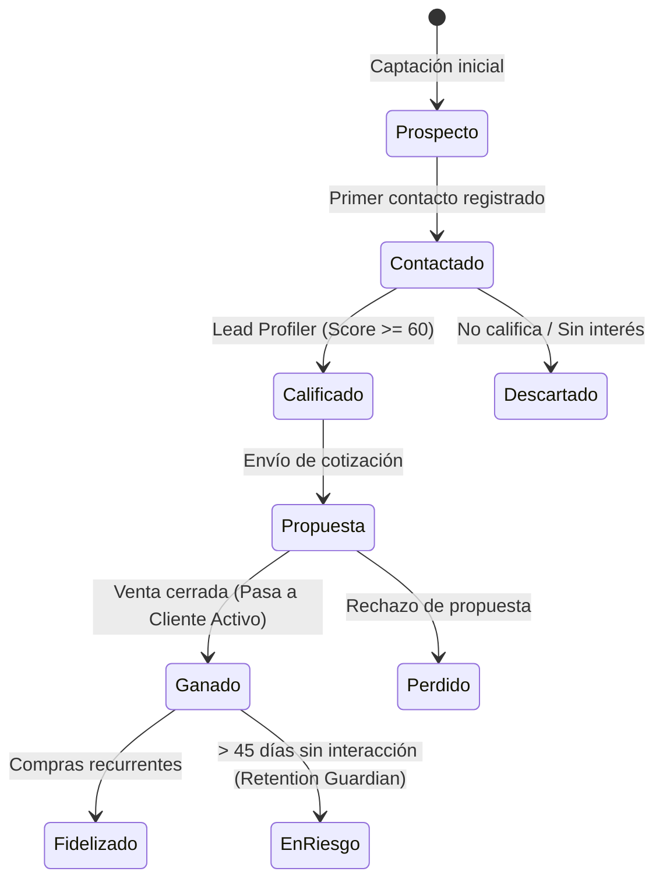

# Directiva de Sector: CRM y Gestión de Clientes
> **Identificador:** `directives/build_crm.md` · **Versión:** 1.0 · **Estado:** Activo
> **Skills Asociados:** [`customer_journey`](/.agents/skills/customer_journey/SKILL.md) · [`lead_profiler`](/.agents/skills/lead_profiler/SKILL.md) · [`retention_guardian`](/.agents/skills/retention_guardian/SKILL.md)
> **Directorio de Sector:** [`crm/`](/crm/)

---

## 1. Misión del Sector CRM

Centralizar la información estratégica, historial de contacto, perfil 360° y ciclo de vida de los clientes y prospectos (leads), permitiendo optimizar la conversión comercial y maximizar la retención de cuentas clave.

---

## 2. Flujo del Pipeline Comercial (Funnel de Ventas)

---

## 3. Estados y Etapas del Lead / Oportunidad

| Código | Etapa | Badge CSS | Descripción |
|---|---|---|---|
| `PROS` | Prospecto | `.badge-neutral` | Registro recién ingresado sin contacto previo |
| `CONT` | Contactado | `.badge-info` | Conversación iniciada por canal comercial |
| `CALI` | Calificado | `.badge-warning` | Necesidad y presupuesto validados |
| `PROP` | En Propuesta | `.badge-info` | Presupuesto enviado en espera de decisión |
| `GANA` | Ganado / Cliente | `.badge-success` | Conversión exitosa a cuenta activa |
| `PERD` | Perdido | `.badge-danger` | Oportunidad cerrada sin concretar |

---

## 4. Ficha 360° del Cliente

Cada contacto del CRM debe disponer de su ficha integral compuesta por:
1. **Datos de Identidad**: Razón Social o Nombre, CUIT/DNI, Email, Teléfono, Ubicación, Categoría fiscal.
2. **Segmentación Comercial**: Clasificación (A, B, C), Industria/Rubro, Score del Lead (0-100).
3. **Métricas de Valor**:
   - LTV (Lifetime Value): Total histórico comprado acumulado.
   - Ticket Promedio: Promedio por venta cerrada.
   - Última Fecha de Compra / Contacto.
4. **Timeline de Interacciones**: Registro cronológico de llamadas, mensajes de WhatsApp, notas de reunión y correos enviados.
5. **Historial de Ventas**: Enlace directo a las órdenes generadas en el sector Ventas.

---

## 5. Skills Responsables

1. **`customer_journey`**:
   - Gestiona el pipeline visual tipo Kanban/Lista, avance de etapas y registro de interacciones.
2. **`lead_profiler`**:
   - Evalúa el perfil del contacto (capacidad de compra, rubro, necesidad) y computa el puntaje de calificación (Lead Score).
3. **`retention_guardian`**:
   - Monitorea la frecuencia de interacción de clientes activos, detecta riesgo de abandono (churn) y sugiere acciones de fidelización.
