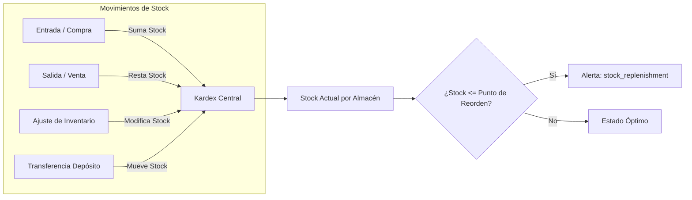

# Directiva de Sector: Stock e Inventario
> **Identificador:** `directives/build_stock.md` · **Versión:** 1.0 · **Estado:** Activo
> **Skills Asociados:** [`inventory_tracker`](/.agents/skills/inventory_tracker/SKILL.md) · [`stock_replenishment`](/.agents/skills/stock_replenishment/SKILL.md) · [`catalog_auditor`](/.agents/skills/catalog_auditor/SKILL.md)
> **Directorio de Sector:** [`stock/`](/stock/)

---

## 1. Misión del Sector Stock

Garantizar la exactitud, disponibilidad y trazabilidad física y lógica del inventario de mercadería, insumos y productos terminados a través de almacenes, controlando entradas, salidas y puntos críticos de reorden.

---

## 2. Flujo de Trazabilidad y Movimientos (Kardex)

---

## 3. Tipos de Movimientos y Reglas Operativas

| Código | Tipo | Efecto | Requiere Comprobante |
|---|---|---|---|
| `ENT_COM` | Entrada por Compra | `+` (Incrementa) | Sí (Remito / Factura Proveedor) |
| `SAL_VEN` | Salida por Venta | `-` (Decrementa) | Sí (ID de Venta del sector Ventas) |
| `AJU_POS` | Ajuste Positivo (Sobrante) | `+` (Incrementa) | Sí (Acta de Auditoría) |
| `AJU_NEG` | Ajuste Negativo (Merma/Rotura)| `-` (Decrementa) | Sí (Motivo justificado) |
| `TRA_DEP` | Transferencia entre Almacenes | Neutro (Mueve A→B) | Sí (Remito interno) |

**Reglas de Oro:**
1. **Prohibido el Stock Negativo Silencioso**: No se puede asentar una salida si el stock disponible en el almacén de origen es inferior a la cantidad solicitada, salvo autorización de excepción explícita.
2. **Kardex Inalterable**: Toda alteración en el stock debe registrar un movimiento fechado con responsable, cantidad, costo unitario y saldo resultante. Nunca se edita el valor de stock directamente en la base de datos sin un asiento en el Kardex.
3. **Momento de Descuento por Venta (Regla 4.4)**: El movimiento `SAL_VEN` se imputa en el momento exacto en que la orden de venta ingresa o pasa a estado `PEN` (Pendiente de Pago), asegurando la reserva física de las unidades. En caso de anulación (`CAN`), se genera un contra-asiento de restitución de stock.

---

## 4. Indicadores de Salud de Inventario

- **Stock Crítico (Quiebre de Stock)**: `stock_actual == 0` (Badge Rojo `.badge-danger`).
- **Bajo Punto de Reorden**: `stock_actual <= punto_reorden` (Badge Amarillo `.badge-warning`).
- **Stock Saludable**: `stock_actual > punto_reorden` (Badge Verde `.badge-success`).
- **Sobre-stock**: `stock_actual > stock_maximo` (Badge Azul `.badge-info`).

---

## 5. Skills Responsables

1. **`inventory_tracker`**:
   - Asienta movimientos de entrada/salida y mantiene actualizado el saldo del Kardex en tiempo real.
2. **`stock_replenishment`**:
   - Calcula rotación (lead time, consumo promedio diario) y emite órdenes de compra sugeridas al alcanzar el punto de reorden.
3. **`catalog_auditor`**:
   - Audita consistencia de SKUs, categorías, códigos de barras, listas de precios vinculadas y diferencias entre conteo físico e inventario lógico.
