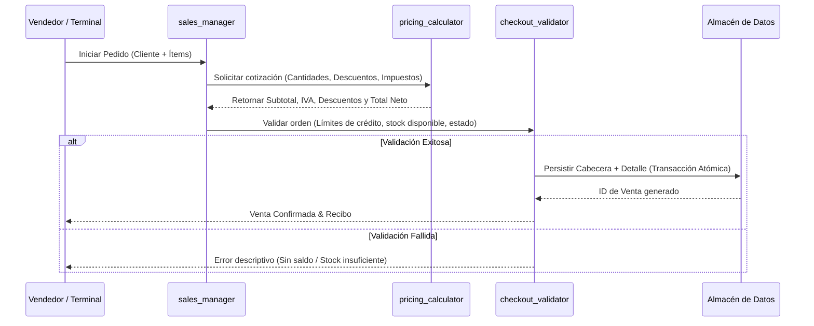

# Directiva de Sector: Ventas y Facturación
> **Identificador:** `directives/build_ventas.md` · **Versión:** 1.0 · **Estado:** Activo
> **Skills Asociados:** [`sales_manager`](/.agents/skills/sales_manager/SKILL.md) · [`pricing_calculator`](/.agents/skills/pricing_calculator/SKILL.md) · [`checkout_validator`](/.agents/skills/checkout_validator/SKILL.md)
> **Directorio de Sector:** [`ventas/`](/ventas/)

---

## 1. Misión del Sector Ventas

Gestionar de forma integral el ciclo transaccional de ventas: desde la generación de presupuestos/cotizaciones hasta la confirmación de la orden, aplicación de reglas de precios, cobros y cierre con emisión de comprobante comercial.

---

## 2. Flujo Operativo de Venta

---

## 3. Matriz de Estados de la Venta

| Código | Estado | Badge CSS | Acciones Permitidas |
|---|---|---|---|
| `COT` | Cotización / Borrador | `.badge-neutral` | → Confirmar, → Cancelar, Editar ítems |
| `PEN` | Pendiente de Pago | `.badge-warning` | → Cobrar, → Cancelar |
| `PAG` | Pagado | `.badge-info` | → Despachar / Entregar |
| `ENT` | Entregado / Completado | `.badge-success` | (Estado Final) |
| `CAN` | Cancelado / Anulado | `.badge-danger` | (Estado Final con Reversión) |

**Reglas de Transición y Stock (Regla 4.4):**
1. Solo se puede cancelar una venta en estado `COT` o `PEN`. Si ya está `PAG`, requiere nota de crédito / reversión formal.
2. Un pedido en `ENT` o `CAN` es inmutable.
3. **Baja y Compromiso de Stock (Regla 4.4)**: El stock físico/lógico se **da de baja inmediatamente al ingresar o pasar a estado `PEN` (Pendiente de Pago)**, asegurando la reserva de los artículos para el cliente. En `PAG` (Pagado) el stock permanece descontado. Las cotizaciones (`COT`) no impactan en stock físico. Si una orden en `PEN` o `PAG` es anulada (`CAN`), el sistema reintegra de forma automática las existencias al inventario disponible.

---

## 4. Estructura de Datos de la Venta

### Cabecera de Venta (`VentaCabecera`)
- `id_venta`: UUID o autoincremental único.
- `fecha`: Fecha y hora de emisión.
- `id_cliente`: Referencia al cliente en CRM.
- `estado`: Código de estado (`COT`, `PEN`, `PAG`, `ENT`, `CAN`).
- `subtotal`: Suma de subtotales de ítems antes de descuentos e impuestos.
- `descuento_total`: Descuento global aplicado.
- `impuestos_total`: IVA / tributos aplicados.
- `total`: Monto final exigible.
- `metodo_pago`: Efectivo, Transferencia, Tarjeta, Cuenta Corriente.
- `observaciones`: Comentarios y condiciones de entrega.

### Detalle de Venta (`VentaDetalle`)
- `id_detalle`: ID de línea de pedido.
- `id_venta`: Vínculo a la cabecera.
- `id_producto`: ID del artículo en Stock.
- `descripcion`: Nombre del producto congelado al momento de la venta.
- `cantidad`: Cantidad de unidades vendidas.
- `precio_unitario`: Precio de lista al momento de la transacción.
- `descuento_porcentaje`: Descuento unitario si aplica.
- `subtotal_linea`: `(cantidad * precio_unitario) * (1 - descuento_porcentaje/100)`.

---

## 5. Skills Responsables

1. **`sales_manager`**:
   - Gestiona el carrito de compras, selección de clientes y navegación entre órdenes.
2. **`pricing_calculator`**:
   - Calcula subtotales, recargos por medio de pago, descuentos por volumen e impuestos.
3. **`checkout_validator`**:
   - Valida condiciones previas al commit final: cliente habilitado, campos obligatorios completos, totales consistentes.

---

## 6. Normas de Interfaz e Interacción en el Punto de Venta (Terminal de Ventas)

Estas directivas son de cumplimiento obligatorio y son auditadas por la suite de regresión (`/tests/`):

### 6.1. Búsqueda Predictiva y Autocompletado
1. **Cliente**:
   - Umbral estricto: Ningún desplegable debe mostrarse hasta que se hayan tipeado **al menos 3 caracteres** (`query.length >= 3`).
   - Al seleccionar o aceptar un cliente, el campo de búsqueda se oculta y el cliente queda **fijo** en un bloque estructurado (`.client-fixed-card`) con estado visual de confirmación y botón contextual de **"Editar"** para reabrir la búsqueda.
2. **Código de Producto**:
   - Umbral: Se activa inmediatamente a partir del **primer carácter** tipeado (`query.length >= 1`).
   - Contenido del Desplegable: Debe exhibir **únicamente el código** de forma limpia y compacta, sin mezclar descripción ni precios dentro del selector de código.
3. **Descripción del Producto**:
   - Umbral estricto: Ningún desplegable debe mostrarse hasta que se hayan tipeado **al menos 3 caracteres** (`query.length >= 3`).
   - Muestra descripción principal, código asociado y precio formateado en pesos argentinos (`ARS`).
4. **Búsqueda por Precio**:
   - Búsqueda predictiva a partir de valores numéricos ingresados, vinculando automáticamente la descripción y el código correspondiente al coincidir.

### 6.2. Navegación e Interacción por Teclado
1. **Navegación Vertical con Flechas**:
   - Con cualquier desplegable abierto (`clienteDropdown`, `codigoDropdown`, `productoDropdown`, `precioDropdown`), las teclas **`ArrowDown`** (Flecha Abajo) y **`ArrowUp`** (Flecha Arriba) deben ciclar entre las opciones disponibles.
   - El elemento seleccionado debe recibir la clase `.active` (fondo `#dbeafe` y color `#1d4ed8`), con desplazamiento automático visible (`scrollIntoView({ block: 'nearest' })`).
   - Sincronización con ratón: el evento `onmouseenter` debe sincronizar el índice activo para que teclado y ratón operen de manera intercambiable.
2. **Confirmación con `Enter` (Intro)**:
   - Si el desplegable está visible, pulsar `Enter` selecciona inmediatamente la opción activa y transfiere el foco al siguiente campo lógico.
   - Si el desplegable está cerrado, `Enter` avanza secuencialmente el cursor: `Código` → `Descripción` → `Precio` → `Cantidad`.
   - En el campo `Cantidad`, pulsar `Enter` verifica la existencia de duplicados y:
     - Si es la última fila del pedido, **agrega automáticamente una nueva fila de producto** y le otorga el foco a su campo de código.
     - Si no es la última, avanza el foco al código de la fila siguiente.

### 6.3. Consolidación de Productos Duplicados
- Si se ingresa el mismo código o descripción que ya existe en otra línea del pedido en curso, el sistema **no debe generar una fila duplicada**.
- Debe **sumar automáticamente las cantidades** a la fila original existente, recalcular sus subtotales y remover la fila redundante.

### 6.4. Política Estricta de Diálogos Nativos (Cero Alerts Feos)
- **Prohibición Total de Diálogos Nativos**: Queda estrictamente vedado el uso de `window.alert()`, `window.confirm()` o `window.prompt()`.
- **Notificaciones In-App**: Mensajes de advertencia o error deben presentarse mediante tarjetas toast temporales flotantes (`.toast-card`).
- **Confirmación de Operaciones**: El cierre exitoso de venta debe desplegar un modal corporativo de comprobante (`#modalExitoVenta`) con detalle estructurado e iconografía Phosphor.

### 6.5. Parámetros Comerciales
- **Condición de Pago**: Omitida temporalmente de la interfaz gráfica hasta su redefinición con pasarelas de pago.

### 6.6. Apertura Directa y Edición In-Place de Registros (Historial, Clientes y Proveedores)
1. **Acceso Directo Sin Páginas Intermedias**:
   - Las acciones de Clientes y Stock en el hub central abren directamente los modales in-place sin redirecciones a páginas secundarias.
2. **Edición al Clicar sobre Registros**:
   - **Historial de Ventas**: Al pulsar sobre cualquier fila de venta/pedido, se abre el modal `#modalNuevaVenta` en modo edición cargando el ID de pedido, cliente, detalle de ítems, totales y selector de estado (`PAG`, `PEN`, `COT`, `CAN`).
   - **Directorio de Clientes**: Al hacer clic sobre cualquier fila del directorio de clientes, se abre `#modalNuevoCliente` en modo edición con los datos precargados para su actualización inmediata y sincronización en `localStorage`.
   - **Directorio de Proveedores**: Al hacer clic sobre cualquier fila de proveedores, se abre `#modalEditarProveedor` para modificar razón social, persona de contacto, teléfono y email oficial.
   - **Gestión de Inventario**: Al pulsar sobre cualquier producto del inventario, se abre `#modalEditarProducto` para modificar stock, precio, estado y denominación.
3. **Indicadores de Interactividad**:
   - Todas las filas de tablas de gestión muestran cursor de mano (`cursor: pointer`), resaltado hover (`#f1f5f9`), tooltip explicativo y botón visual de acción contextual ("Editar").
4. **Ordenamiento Dinámico por Encabezados de Campo**:
   - Todas las tablas del sistema (Directorio de Clientes, Gestión de Inventario, Directorio de Proveedores e Historial de Pedidos) permiten ordenar sus registros de forma bidireccional (ascendente y descendente) pulsando directamente sobre el nombre de cada campo.
   - En el **Directorio de Clientes**, los campos **Nombre** y **Apellido** cuentan con columnas y ordenamiento independiente para permitir clasificar por nombre de pila o por apellido paterno/materno de forma inmediata.
   - Cada columna ordenable cuenta con indicadores visuales interactivos (`▲`, `▼`, `↕`), clases de estado `.active-asc` / `.active-desc` y tooltips contextuales.

